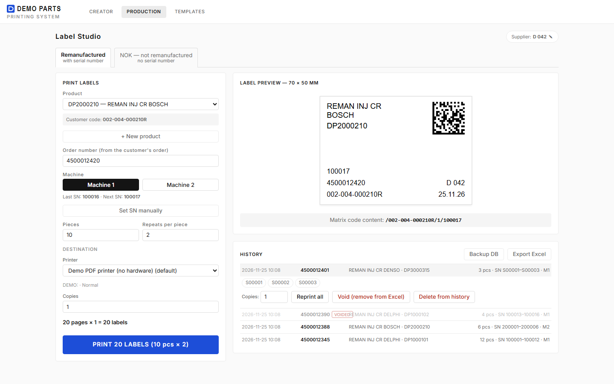
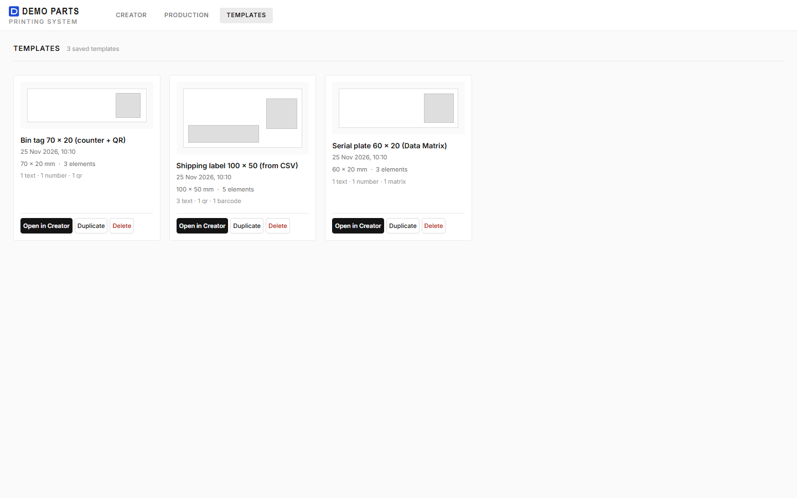
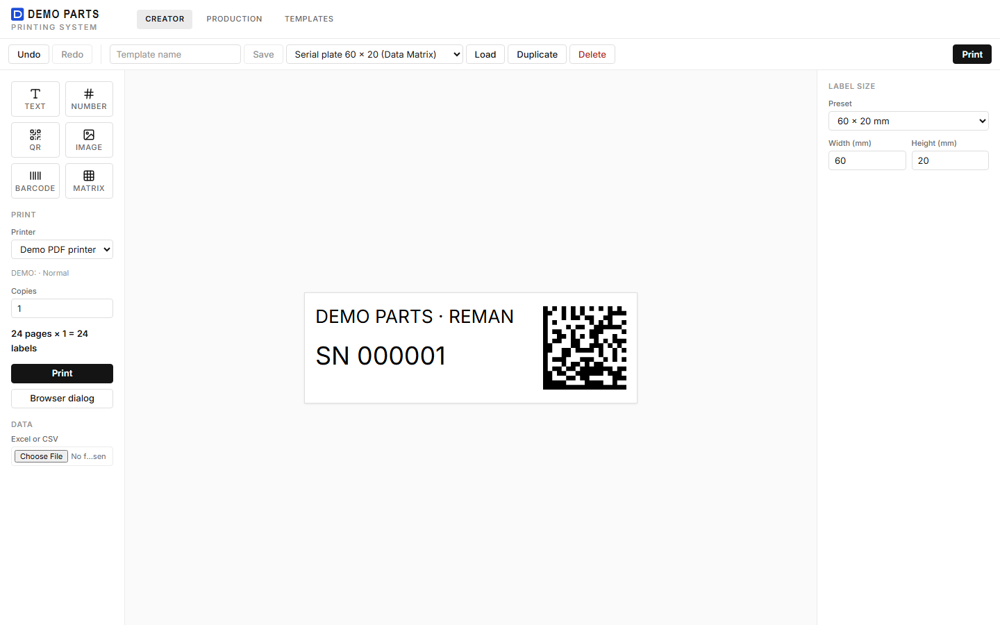
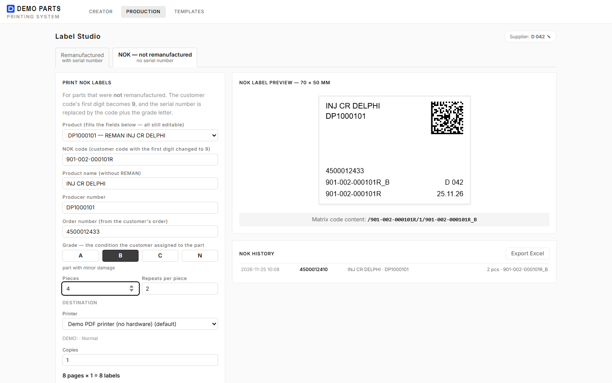

# Label Studio demo

[](https://github.com/Oparavitalii/label_studio_demo/actions/workflows/ci.yml)

Public copy of a production system: label design and batch printing for a company that remanufactures Common Rail injectors (client name withheld). Templates, batches with serial numbers and Data Matrix codes, and separate labels for parts that were not remanufactured (NOK).

I (Vitalii Opara) built it in 2026 and it runs on the shop floor on Windows, printing to a Zebra label printer. In this copy the brand is replaced with the fictional "Demo Parts", and the client's customer, its codes and every serial and order number are invented. The code and the engineering decisions are the production ones.

- **Run it with zero hardware:** `npm install && npm run demo` → http://localhost:5173 (a virtual printer renders each job to a PDF)
- Companion repos from the same client: [b2b_portal_demo](https://github.com/Oparavitalii/b2b_portal_demo) (B2B ordering portal) and [catalog_shop_demo](https://github.com/Oparavitalii/catalog_shop_demo) (WooCommerce shop and catalogue import)



## What it does

- **Label designer (Creator).** A WYSIWYG editor in millimetres: text, counters, QR, Code 128 / EAN-13 barcodes, Data Matrix and images. Drag, resize, undo / redo, label-size presets (60×20 to 100×50 mm) or a custom size. A `number` element turns one design into a numbered run of labels.
- **Templates.** Designs are saved as templates (browser storage) and opened back into the Creator, duplicated or deleted.
- **Data-driven labels.** Import an Excel (`.xlsx`) or CSV file and write `{Column}` tokens on the label: one label per row.
- **Production batches.** Pick a product, the order number, the machine and the quantity. The server hands out the next serial numbers in that machine's range (`1xxxxx` / `2xxxxx`) inside one transaction, stores the batch and prints a 70×50 mm label per piece. Each label carries a Data Matrix `/CODE/1/SN` that encodes exactly the serial printed above it. "Repeats per piece" prints several copies of each label.
- **Manual serial numbers.** The operator can override the counter with any format (`000042`, `S00001`, `AB-09`). It prints exactly as typed and counts up inside its own width (`S00001` → `S00002`). Only a plain six-digit SN inside a machine range moves that machine's counter.
- **NOK labels.** Parts that came back and were not remanufactured get a different label, as the customer's supplier manual requires: the code's first digit changes from 0 to 9, the serial is replaced by `<code>_<grade>` (grades A / B / C / N), and the word REMAN is dropped from the name. NOK runs live in their own table and can never consume a serial number.
- **History and reports.** Reprint a whole batch or only selected serials, void a batch (it leaves the report but keeps its serials) or delete it. The Excel report has Labels, Orders, Voided and NOK sheets. Plus a one-click database backup.
- **Printing.** Pick the printer and the copies in the app. The server renders the job to a PDF at the exact label size and sends it to the Windows printer. If the print server is not available, the app falls back to the browser's print dialog. Every run ends with an operator check: "Did all N labels print correctly?"

Templates:



Creator, with a Data Matrix serial-plate template open:



NOK label (part not remanufactured, grade B):



## Architecture

```
React SPA (Vite)                          Express server (Node 22+)
  Creator ── zustand + zundo store          /api/state, /api/products, /api/settings
  Templates ── localStorage                 /api/batches ── serial allocation (BEGIN IMMEDIATE)
  Production ── OK tab / NOK tab ──/api──▶  /api/nok-batches
  /print/:jobId ── render target            /api/import (.xlsx, ExcelJS), /api/report.xlsx
        ▲                                   /api/backup (VACUUM INTO)
        │                                          │
        │                                   node:sqlite (WAL): settings, products,
        │                                   batches, labels, nok_batches
        │
        └── headless Chrome (raw DevTools protocol) ◀── POST /api/print/jobs → POST /api/print
                      │
              PDF at the label size ──▶ Windows spooler (PowerShell)
                                        demo: the PDF goes back to the browser
```

## Engineering highlights

- **Serial numbers that never repeat by accident.** The next serial is `MAX(serial) + 1` inside the machine's range, read and written in one `BEGIN IMMEDIATE` transaction. Voiding a batch keeps its serials used; only a permanent delete gives them back. A serial is stored as prefix + digit width + integer, so manual formats like `S00001` coexist with the six-digit automatic ones without touching the counter, the range checks or the ordering.
- **One rule set, tested.** The label rules (serial parsing and formatting, the OK and NOK Data Matrix payloads, the 0 → 9 NOK code, the grade letters) are pure functions in `Server/label_rules.js`. The routes validate every value again on the server; the browser only pre-fills.
- **Snapshots, not references.** Each batch copies the product's code, name and producer number at print time, so history, reprints and reports always show what was physically printed, even after a product is edited.
- **Printing a browser cannot do.** The document goes to the server as a job, a fresh headless Chrome opens the app's own `/print/:jobId` route over the DevTools protocol (no Puppeteer), waits for a `data-print-ready` marker that is set only after every code has rendered, and prints to PDF with `preferCSSPageSize`, so a 70×50 label is a 70×50 page. The PDF goes to the chosen printer through PowerShell, with a fallback for machines whose `.pdf` association has no `printto` verb. Jobs live in memory with a TTL and a size cap, never in the print log.
- **A print log that does not lie.** Serials are allocated before the print, and a failed print is reported loudly but never retried on its own: the operator confirms, or reprints the same serials.
- **Safe operations.** `node:sqlite` in WAL mode with no native dependencies, a `VACUUM INTO` backup on every start (the last 14 are kept) and on demand. `LABEL_DATA_DIR` / `LABEL_PORT` let tests run their own server on a throwaway database.
- **A machine-checked design system.** `npm run check:style` walks the import graph from `src/main.jsx` and asserts the rules of the shipped CSS: neutral greys only, one accent element per screen, namespaced classes, no unused classes.

## Stack

- **Frontend:** React 19, Vite 7, React Router 7, Zustand + zundo (undo / redo), react-rnd, bwip-js (Data Matrix), JsBarcode, qrcode, lucide-react
- **Backend:** Node.js 22+, Express 4, `node:sqlite`, ExcelJS, headless Chrome over the DevTools protocol, PowerShell (Windows printing)
- **Tooling:** Vitest, ESLint 9 + Prettier, GitHub Actions

## Run locally (demo mode)

Requirements: Node.js 22.13+ (production runs Node 24). For the PDF render: Google Chrome, Playwright's Chromium (`npx playwright install chromium`), or any Chrome set in `CHROME_PATH`.

```bash
npm install
npm run demo          # same as npm run dev
```

- The app opens on http://localhost:5173 (Vite), with the label server on :5180.
- The database lives in `.demo_data/`. On first start it is seeded with invented products, four batches (machine 1, machine 2, a voided one, a manual `S00001` run) and one NOK run, through the real API (`scripts/demo_seed.mjs`). `npm run demo:reset` starts it clean.
- Three example templates are saved into the browser on first load.
- The printer list holds one **Demo PDF printer (no hardware)**. Printing to it runs the real render pipeline and gives you a link to the PDF instead of sending it to a spooler. The first run builds `dist/` once, because the headless render uses the built app.
- `demo/fixtures/orders.csv` is a sample file for the Creator's Excel / CSV import.

Production-style run on Windows: `npm start` builds the app and serves everything from the Express server on :5180, with the real Windows printer list. Environment variables are listed in `.env.example`; none are required.

## Tests

- `npm test`: Vitest, 179 tests in 5 files.
  - `Server/label_rules.test.js`: serial parsing and formatting, Data Matrix payloads, NOK code and name rules, spreadsheet cell text.
  - `Server/api.test.js`: the real server process on a temporary database. Serial allocation per machine, manual serials, range limits, NOK runs that never move a counter, void and delete, the Excel report sheets, `.xlsx` import, print-job validation.
  - `src/labels/**`: the editor model (counters, tokens, datasets, text metrics, template storage) and the store (undo / redo).
- `npm run lint`, `npm run build`, `npm run check:style`.
- Optional, need Chrome: `npm run verify:nok` posts a NOK run to a throwaway server and checks the PDF bytes; `npm run verify:print -- http://localhost:5173/creator` prints the Creator through headless Chrome and checks page count and page size.

## What was removed for the public version

- The client's name, logo, brand colour and wording; the name of its customer and the customer's codes. Replaced with "Demo Parts", a placeholder logo and "customer code".
- The production database (print log and serial counter), photos of real labels, internal project notes and the delivery package for the shop-floor PC.
- Every serial number, order number and product code in this repo is invented.
- The git history: this copy starts from a single commit.
- Added for the demo: `DEMO_MODE` (virtual PDF printer), the seed script and fixtures, and the `Server/label_rules.js` module with its tests. The rule functions are the production code, moved out of `Server/index.js`.

Built by Vitalii Opara — [u2use.com](https://u2use.com)
